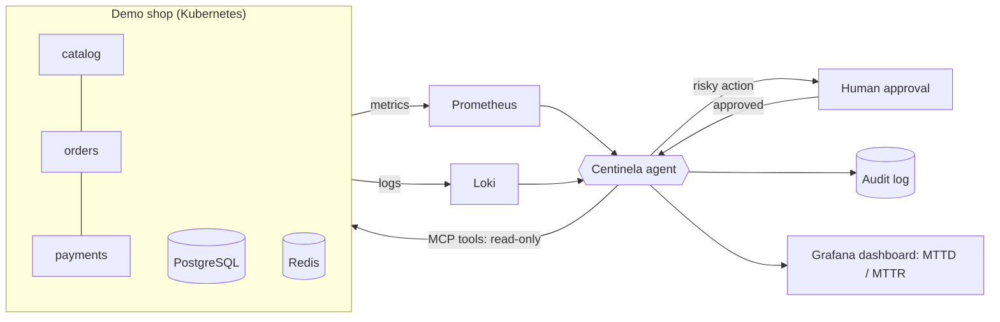

# Centinela

> **AI SRE agent** that watches a microservices app, detects incidents, diagnoses the root cause from metrics and logs, and fixes them safely — asking a human before any risky action.

[](https://github.com/Fabricioanchundia/IA-CENTINELA/actions/workflows/ci.yml)


🚧 **Work in progress.** Built in public, phase by phase. Results with real numbers will be published here as each phase lands.

## What it does (target)



1. **Detect** — alerts from Prometheus and Loki.
2. **Diagnose** — a local LLM (Ollama on GPU) reasons over metrics, logs, runbooks (RAG) and past incidents.
3. **Act safely** — only allow-listed actions through its own **MCP server**, least-privilege Kubernetes RBAC, human-in-the-loop for risky steps, every decision audited.
4. **Resist manipulation** — logs can contain prompt-injection payloads; the agent must detect and ignore them (tested).
5. **Prove it** — 20+ chaos scenarios measuring diagnosis accuracy, resolution rate, false positives, time and cost.

## Roadmap

| Phase | Scope | Status |
|---|---|---|
| 0 | Repo, security settings, CI, project skeleton | ✅ |
| 1 | Fundamentals refresh (folded into later phases) | ⏭️ |
| 2 | Demo microservices app (3 services + PostgreSQL + Redis) in Docker | ✅ |
| 3 | Observability: Prometheus, Grafana, Loki, OpenTelemetry → **v0.1** | ⏳ |
| 4 | Local Kubernetes (k3d) + Terraform | ⏳ |
| 5 | Incident data pipeline + history | ⏳ |
| 6 | Agent v1: diagnose only (read-only) → **v0.5** | ⏳ |
| 7 | MCP server + human-approved actions | ⏳ |
| 8 | Agent security + prompt-injection defense | ⏳ |
| 9 | Chaos engineering + evaluation | ⏳ |
| 10 | Cloud demo + full CI/CD | ⏳ |
| 11 | Docs, video, results → **v1.0** | ⏳ |

## Designed for a 16 GB laptop

The whole stack is built to run on a laptop with **16 GB RAM** and an **8 GB GPU** — see [ADR-0002](docs/adr/0002-resource-budget-16gb.md).

| Component | Budget |
|---|---|
| Windows + editor + browser | ~6 GB |
| WSL2 (Docker, k3d, observability, agent) | capped at 6–8 GB |
| LLM (Ollama, `qwen2.5:7b`) | runs in **GPU VRAM**, not system RAM |

## Run the demo shop

```bash
cp .env.example .env            # first time only
docker compose up -d --build    # catalog :8001, orders :8002, payments :8003
./scripts/smoke.sh              # end-to-end check: list products, place and read an order
docker compose down             # stop everything and free memory
```

| Service | Port | What it does | Depends on |
|---|---|---|---|
| `catalog` | 8001 | Products and prices | PostgreSQL, Redis (cache, optional) |
| `orders` | 8002 | Places orders | catalog, payments, PostgreSQL |
| `payments` | 8003 | Fake payment gateway | PostgreSQL |

Every service exposes `/healthz`, `/readyz` and interactive API docs at `/docs`. Logs are JSON lines with a shared `request_id`. Design notes: [ADR-0003](docs/adr/0003-demo-shop-design.md).

## Quick start (development)

Requirements: WSL2 (Ubuntu 24.04), [uv](https://docs.astral.sh/uv/), Docker.

```bash
uv sync --all-packages       # install dependencies (agent + shop)
uv run pre-commit install    # run checks before every commit
uv run pytest                # tests
uv run centinela --version
```

## Engineering practices

- Conventional Commits, feature branches, PRs with green CI before merge
- `ruff` (lint + bandit security rules), `mypy --strict`, `pytest` with coverage
- Secret scanning: GitHub push protection + `gitleaks` (pre-commit and CI)
- Dependabot for Python dependencies and GitHub Actions
- Architecture Decision Records in [`docs/adr/`](docs/adr/)

## License

[MIT](LICENSE)
